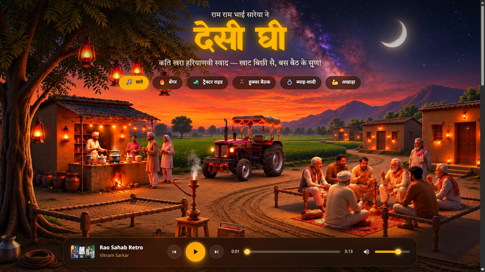

 <div align="center">

# 🪕 देसी घी (Desi Ghee)

**100% खरा हरियाणवी स्वाद — एक डिजिटल हरियाणवी चौपाल**

[](https://desi-ghee.netlify.app/)
[](https://developer.mozilla.org/en-US/docs/Web/JavaScript)
[](LICENSE)
[](#-architecture--playback-engine)

A high-performance, ambient web radio player dedicated to authentic Haryanvi music. Built with zero frontend frameworks, featuring an earthy glassmorphic interface, canvas firefly ("Jugnu") particles, and a mobile-resilient dual-engine audio pipeline.

[Explore Demo](https://desi-ghee.netlify.app/) • [Report Issue](https://github.com/devagarwal2709/DesiGhee/issues) • [Request Track](mailto:desighee02@gmail.com)

</div>

---

## 📸 Preview

<div align="center">
  
</div>

---

## 🌾 Overview

Desi Ghee recreates the atmosphere of a village *chaupal* at dusk — complete with traditional string beds (*khat*), ambient hookah glows, drifting dust, and continuous rural anthems.

The application runs entirely in the browser using modern web standards, without bundlers, heavy Node.js runtimes, or client-side frameworks.

### 📁 Project Structure

```text
DesiGhee/
├── index.html              # Semantic HTML5 and embedded headless audio wrappers
├── css/
│   └── style.css           # Earthy glassmorphic design system and responsive layout
├── js/
│   ├── songs.js            # Curated track database across five mood categories
│   ├── player.js           # Unified dual-engine audio controller (YouTube + SoundCloud)
│   └── app.js              # DOM binding, canvas particles, and UI reactivity
└── assets/
    ├── images/             # Optimized hero and category artwork, plus preview.png
    └── icons/              # Favicon assets and branding SVGs
```

---

## ⚡ Key Features

- **Dual-Engine Headless Playback:** Seamlessly switches between the **YouTube IFrame Player API** and **SoundCloud Widget API (`SC.Widget`)** behind an entirely custom playback dock.

- **Ambient Canvas Animation ("Jugnu"):** A custom 2D HTML5 canvas simulation rendering floating, glowing firefly particles with soft radial alpha trails.

- **Zero CLS and Mobile Optimization:** Uses `100svh`, CSS containment, safe-area inset accounting (`env(safe-area-inset-bottom)`), and responsive 3×2 grid arrangements on narrow displays.

- **Watchdog and Autoplay Resilience:** Supports automatic gesture-block recovery through the `autoplayblocked` event, auto-skips embed-restricted tracks, and uses pre-warming handshakes to reduce cold-start latency.

- **Background Track Duration Probe:** An asynchronous hidden probe player checks and stores track durations in `localStorage`, helping eliminate playback stutter and layout shifts.

- **Strict Streaming Compliance:** Streams audio through official embedded players only, with no server-side audio hosting or pirated media files.

---

## 🎛️ Architecture & Playback Engine

Most music streaming clients rely on visible widgets that can disrupt the listening experience. Desi Ghee isolates playback into a headless audio layer, allowing a fully custom interface.

### Playback Architecture

```text
┌─────────────────────────────────────────────┐
│       User Interaction: Mood Pills          │
│              and Dock Controls               │
└──────────────────────┬──────────────────────┘
                       │
                       ▼
              ┌────────────────┐
              │     app.js     │
              └───────┬────────┘
                      │
                      ▼
          ┌────────────────────────┐
          │       player.js        │
          │  Unified Audio Engine  │
          └───────────┬────────────┘
                      │
             ┌────────┴────────┐
             ▼                 ▼
    ┌────────────────┐  ┌────────────────┐
    │  YouTube API   │  │ SoundCloud API  │
    ├────────────────┤  ├────────────────┤
    │ Playsinline    │  │ SC.Widget      │
    │ Origin-bound   │  │ Eager pre-warm │
    │ HQ thumbnails  │  │ Widget bridge  │
    └────────┬───────┘  └────────┬───────┘
             │                   │
             └─────────┬─────────┘
                       │
                       ▼
          ┌────────────────────────┐
          │    Event Stream        │
          │ Progress, Volume, State│
          └───────────┬────────────┘
                      │
                      ▼
          ┌────────────────────────┐
          │  Custom Bottom Dock UI │
          └────────────────────────┘
```

### 🎵 Supported Moods & Categories

| Mood | Label | Hinglish | Vibe |
|:---:|---|---|---|
| 🔥 | **बेंगर** | BANGER | Heavy 808s, driving basslines, and high energy |
| 🚜 | **ट्रैक्टर राइड** | TRACTOR RIDE | Upbeat rural road anthems and folk tunes |
| 🪑 | **हुक्का बैठक** | HUKKA BAITHAK | Chill evening discussions and mid-tempo flows |
| 💍 | **ब्याह-शादी** | BYAH-SHADI | Celebratory wedding beats and folk party tracks |
| 💪 | **अखाड़ा** | AKHADA | High-intensity workout and wrestling rhythms |

---

## 🎨 Design Tokens

The styling follows an earthy, warm glassmorphic aesthetic defined by custom CSS properties.

```css
:root {
  --ink: #15120e;             /* Deep Night Base */
  --amber: #f59e0b;           /* Accent Glow */
  --saffron: #ffb300;          /* Primary Brand Highlight */
  --cream: #ede3cf;            /* High-Contrast Foreground Text */
  --glass-bg: rgba(22, 16, 12, 0.78);
  --glass-border: rgba(245, 158, 11, 0.28);
}
```

---

## 🚀 Local Development Setup

No `npm install` or build step is required. Run a local development server over HTTP or HTTPS to allow the embedded players to initialize correctly.

### 1. Clone the Repository

```bash
git clone https://github.com/devagarwal2709/DesiGhee.git
cd DesiGhee
```

### 2. Start a Local Server

**Option A: VS Code Live Server**

1. Open the project folder in VS Code.
2. Right-click `index.html`.
3. Select **Open with Live Server**.

**Option B: Python**

```bash
python -m http.server 5500
```

**Option C: Node.js**

```bash
npx serve .
```

### 3. Open the Application

If you use Python's HTTP server, visit:

[http://localhost:5500](http://localhost:5500)

If you use another server, open the local URL and port displayed by that server.

---

## 📜 Disclaimer & Licensing

Desi Ghee is an open-source, non-commercial fan tribute dedicated to regional Haryanvi culture.

- **Audio Streaming:** All audio playback is streamed directly through publicly accessible embedded players from YouTube and SoundCloud.

- **Copyright:** No audio files or music tracks are hosted, stored, distributed, or made available for download by this platform. All applicable rights belong to their respective singers, lyricists, composers, publishers, and record labels.

- **Third-Party Services:** Playback availability, embedding permissions, and content restrictions are subject to the respective platforms and rights holders.

- **License:** This project is licensed under the MIT License. See the [LICENSE](LICENSE) file for details.

---

<div align="center">

**देसी घी — हरियाणा की मिट्टी, हरियाणा का संगीत।** 🪕🌾

Made with ❤️ for Haryanvi culture.

</div>
